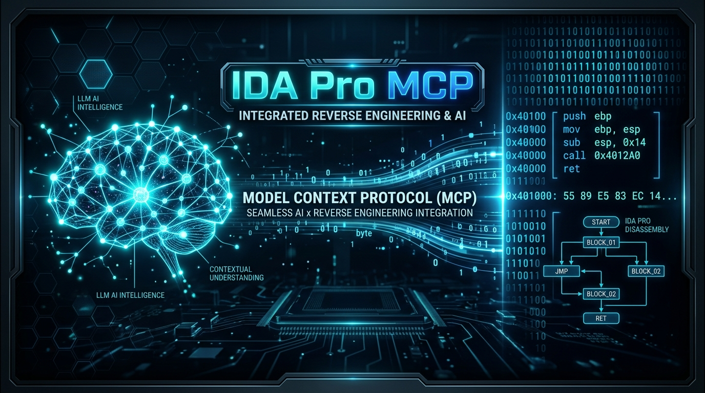
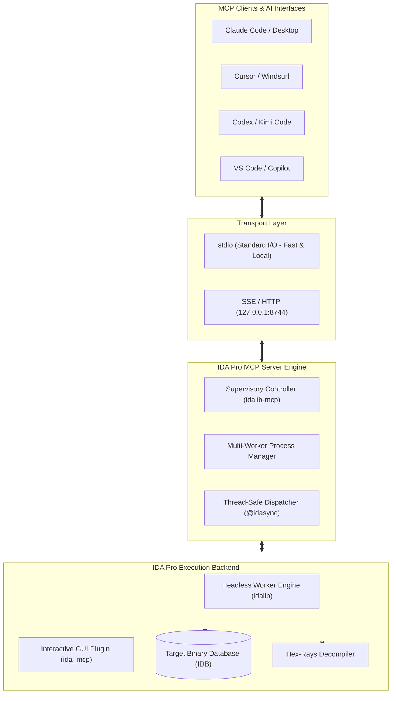
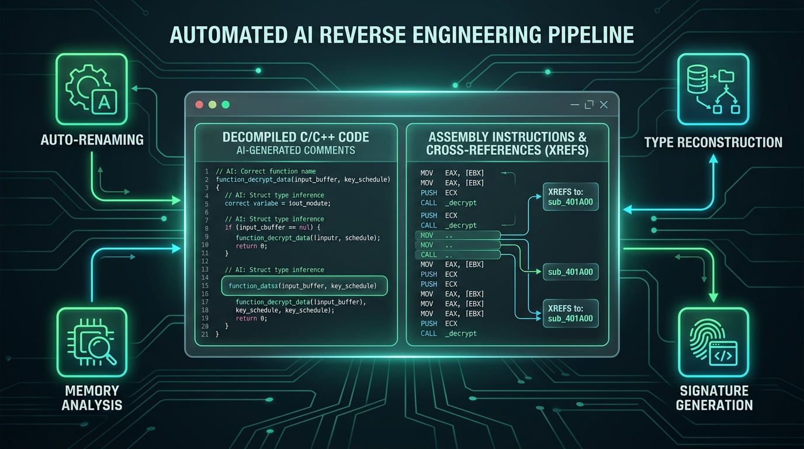

# 🧠 IDA Pro MCP Server — AI-Powered Binary Reverse Engineering
### The Intelligent Bridge Between Modern Large Language Models & IDA Pro

<div align="center">



[](https://python.org)
[](https://hex-rays.com)
[](https://modelcontextprotocol.io)
[](LICENSE)

</div>

---

## 📌 Table of Contents
- [Project Overview](#-project-overview)
- [Why Model Context Protocol (MCP)?](#-why-model-context-protocol-mcp)
- [System Architecture](#️-system-architecture)
- [Automated AI Reverse Engineering Pipeline](#-automated-ai-reverse-engineering-pipeline)
- [Core Capabilities & Toolsets](#-core-capabilities--toolsets)
- [Real-World Reversing Scenario](#-real-world-reversing-scenario)
- [Installation & Quickstart](#-installation--quickstart)
- [Supported Clients](#-supported-clients)
- [Development & Testing](#-development--testing)

---

## 💡 Project Overview

**IDA Pro** is the industry standard for software disassembly, decompilation, and binary reverse engineering. However, manual binary analysis remains tedious and labor-intensive:
- Deciphering obfuscated decompiler output with cryptically named identifiers (`sub_401A20`, `v12`, `a3`).
- Reconstructing complex structures, pointer types, and memory offsets.
- Tracing cross-references (xrefs) and control flow graphs to map out program logic.

**IDA Pro MCP Server** bridges this gap by exposing IDA Pro's database and analysis engine to modern Large Language Models (LLMs) like Claude 3.5 Sonnet, GPT-4o, Codex, and Gemini through the **Model Context Protocol (MCP)**.

> 🎯 **Core Mission**: Empower AI models to directly "see" and interact with IDA Pro's internal database (IDB) or headless `idalib` sessions. The LLM can autonomously decompile functions, rename variables, reconstruct structs, apply type definitions, annotate code with detailed explanations, and even control the debugger—turning hours of manual reverse engineering into seconds of guided analysis.

---

## 🔌 Why Model Context Protocol (MCP)?

The **Model Context Protocol (MCP)** is an open standard created by Anthropic that functions like a **universal USB-C standard** for connecting AI agents to external tools and data sources.

Instead of relying on fragile copy-pasting or custom one-off scripts:
1. **Standardized Tool Invocations**: Models invoke well-defined, type-safe functions with explicit parameters.
2. **Context-Efficient Resources**: Rather than flooding the model's context window with megabytes of raw binaries, the agent queries specific functions, xrefs, and memory regions on-demand.
3. **Safe & Deterministic Operations**: The server wraps operations in thread-safe IDA SDK decorators, providing structured error feedback and transactional state management.

---

## 🏗️ System Architecture

The architecture separates client interaction, protocol transportation, supervisory session control, and the IDA Pro execution engine:



### Key Modules:
- **`src/ida_pro_mcp/server.py`**: Primary MCP server entry point handling JSON-RPC requests.
- **`src/ida_pro_mcp/idalib_server.py`**: Headless supervisor managing persistent worker processes via `idalib` without requiring a graphical display.
- **`src/ida_pro_mcp/ida_mcp/`**: Modular tool domains:
  - `api_core.py`: Segments, functions, strings, and module import/export metadata.
  - `api_analysis.py`: Decompilation, disassembly, call graphs, xrefs, and pattern scanning.
  - `api_types.py`: Local type declarations, struct definitions, and automatic type inference.
  - `api_modify.py`: In-place byte patching, assembly instruction rewriting, and renaming.
  - `api_debug.py`: Breakpoint management, register inspection, and runtime memory reading.

---

## 🔄 Automated AI Reverse Engineering Pipeline

The illustration below depicts how an AI agent iteratively reasons, queries, and enriches the binary database:



1. **Discovery**: The agent identifies entrypoints, exported APIs, and key function lists (`list_funcs`, `ida://idb/entrypoints`).
2. **Decompilation**: The agent calls `decompile` to retrieve Hex-Rays pseudocode and analyze high-level logic.
3. **Reconstruction & Renaming**: Cryptic variables (`v1`, `sub_401100`) are batch-renamed to semantic identifiers (`user_input_buffer`, `decrypt_payload`) via `rename`.
4. **Type Recovery**: C structs and typedefs are registered via `declare_type` and bound to addresses, restoring struct member offsets and clean dot notation.
5. **Interactive Annotation**: Clear technical findings, encryption algorithms, and parameter semantics are written into IDA comments via `set_comments`.

---

## ⚡ Core Capabilities & Toolsets

| Category | Key Tools | Description |
| :--- | :--- | :--- |
| **Analysis & Decompilation** | `decompile`, `disasm`, `callees`, `basic_blocks` | Fetch Hex-Rays C code, detailed disassembly with stack layouts, and basic block graphs. |
| **Cross-References (Xrefs)** | `xrefs_to`, `xrefs_to_field` | Trace callers of any address or usages of individual struct fields across the database. |
| **Refactoring & Modification** | `rename`, `set_comments`, `patch_asm` | Batch rename identifiers, write persistent comments, and assemble instructions in-place. |
| **Types & Structs** | `declare_type`, `infer_types`, `read_struct` | Declare C prototypes, infer signatures using heuristics, and inspect memory structs. |
| **Memory & Data Reading** | `get_bytes`, `get_int`, `get_string`, `find_regex` | Read typed integers, raw byte buffers, null-terminated strings, and regex-match text. |
| **Debugger Control** | `dbg_start`, `dbg_step_over`, `dbg_regs`, `dbg_bps` | Full debugger supervision: control process execution, toggle breakpoints, read registers. |
| **Dynamic IDAPython** | `py_eval` | Execute arbitrary Python scripts directly in the IDA environment with stdout/stderr capture. |

---

## 🧪 Real-World Reversing Scenario

Consider analyzing a protected binary or resolving a challenge:

```
                  ┌──────────────────────────────┐
                  │    User Prompt to Agent      │
                  │ "Analyze crackme.exe, unpack │
                  │ the validation loop and key" │
                  └──────────────┬───────────────┘
                                 │
                                 ▼
1. Discover Entrypoint      lookup_funcs(queries="main")
                                 │
                                 ▼
2. Fetch Decompiled Code    decompile(addr="0x401050")
                                 │
                                 ▼
3. Trace Key Buffer         xrefs_to(addrs="0x403018")
                                 │
                                 ▼
4. Handle Base Conversion   int_convert(inputs="0x5A") -> ASCII: "Z", Dec: 90
                                 │
                                 ▼
5. Apply Meaningful Names   rename(batch={"local": {"v4": "xor_key", "v8": "input_len"}})
                                 │
                                 ▼
6. Document Logic           set_comments(items=[{"addr": "0x40108A", "comment": "RC4 KSA Init"}])
```

---

## 🚀 Installation & Quickstart

### Prerequisites
- **Python**: 3.11 or higher (managed via [uv](https://astral.sh/uv)).
- **IDA Pro**: 8.3 or higher (IDA Pro 9.0+ recommended with `idalib` activated).
- **IDA Free**: Not supported due to plugin and SDK restrictions.

### 1. Activating idalib (One-Time Setup)

```bash
# Windows
uv run "C:\Program Files\IDA Professional 9.3\idalib\python\py-activate-idalib.py"

# macOS
uv run "/Applications/IDA Professional 9.3.app/Contents/MacOS/idalib/python/py-activate-idalib.py"

# Linux
uv run "/path/to/idapro-9.3/idalib/python/py-activate-idalib.py"
```

### 2. Running the Server

#### Headless Mode (Recommended):
Run an autonomous multi-worker server over standard I/O:
```bash
uv run idalib-mcp --stdio path/to/binary.exe
```

Or run as a background service accessible via HTTP/SSE:
```bash
uv run idalib-mcp --host 127.0.0.1 --port 8745
```

#### Interactive IDA GUI Plugin:
Install the plugin directly into your local IDA installation:
```bash
uv run ida-pro-mcp --install
```

### 3. Client Configuration

#### Claude Code:
```bash
claude plugin marketplace add mrexodia/claude-marketplace
claude plugin install ida-pro-mcp@mrexodia
```

#### Generic MCP Clients (Cursor / VS Code / Windsurf / Codex):
Add the server entry to your client's `mcp.json` configuration file:

```json
{
  "mcpServers": {
    "ida-pro": {
      "command": "uv",
      "args": ["run", "ida-pro-mcp"]
    }
  }
}
```

---

## 💻 Supported Clients

The server is fully compliant with the MCP specification and interoperates with:
- **Claude Code & Claude Desktop**
- **Cursor & Windsurf**
- **Codex & Kimi Code**
- **VS Code & Copilot CLI**
- **LM Studio & Gemini CLI**
- **Custom MCP Client Libraries (Python, Node.js, Go)**

---

## 🛠️ Development & Testing

Run tests headlessly against the regression fixtures:
```bash
# Run tests on crackme fixture
uv run ida-mcp-test tests/crackme03.elf -q

# Run typed structures fixture
uv run ida-mcp-test tests/typed_fixture.elf -q

# Test the MCP server interactively via the MCP Inspector
uv run mcp dev src/ida_pro_mcp/server.py
```

---

<div align="center">

Built for reverse engineers, malware researchers, and security analysts looking to supercharge their workflows with LLMs.

</div>
